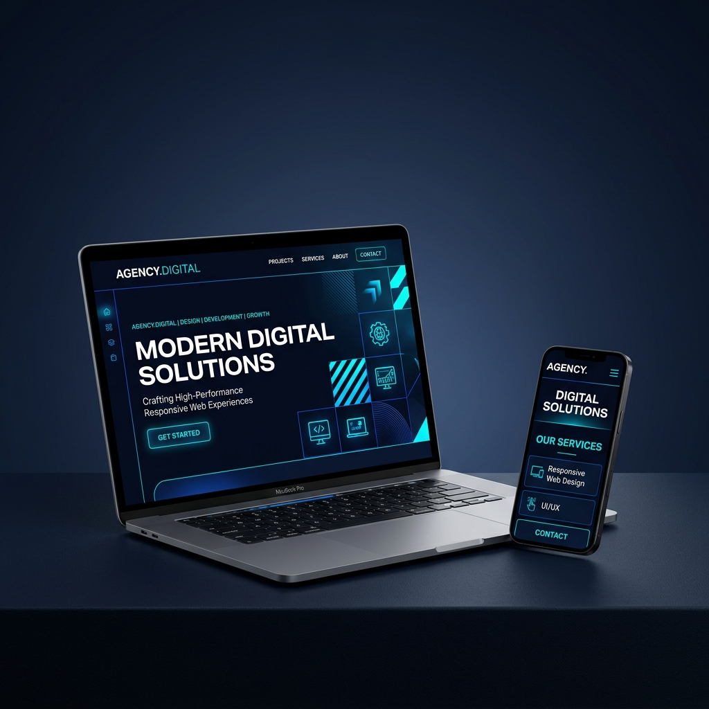

# 스마트스토어 등록용 대표 이미지 (1000 × 1000px)

스마트스토어 상품 등록 가이드라인에 맞추어 디자인된 고품질 대표 이미지 시안입니다.

---

## 🎨 디자인 특징 및 레이아웃 구성
*   **반응형 웹 사이트 상징**: 최신 메탈릭 노트북과 스마트폰 화면에 제주AI파트너 스타일의 다크 블루/시안 테마 웹페이지가 자연스럽게 매칭되어 반응형 전문 제작을 강하게 어필합니다.
*   **텍스트 배치용 여백 확보**: 이미지 상단 및 좌측/우측에 깔끔한 다크 네이비 그라데이션 여백이 존재하여, 텍스트 가독성이 뛰어납니다.
*   **고급 에이전시 톤앤매너**: 네온 블루 광원 효과와 미니멀한 구성으로 신뢰감 있는 고급 웹 제작 에이전시의 이미지를 제공합니다.

---

## ✍️ 추천 텍스트 배치 가이드 (미리캔버스 / 캔바 활용 권장)
인공지능 이미지 생성기 특성상 한글 텍스트를 이미지 내에 직접 쓰면 철자가 깨져서 출력되기 때문에, 위 원본 이미지를 배경으로 깔고 아래 가이드대로 텍스트만 얹으시면 바로 사용하실 수 있습니다.

### 1. 메인 타이틀 (상단 또는 노트북 위 여백)
*   **문구**: `소상공인 맞춤 1페이지 모바일 반응형 웹사이트`
*   **추천 폰트**: Gmarket Sans(지마켓 산스) 또는 프리텐다드(Pretendard) Bold
*   **색상**: 화이트(White) + 강조하고 싶은 글자(`1페이지`, `반응형`)는 민트(Cyan) 또는 옐로우색상 적용

### 2. 가격 혜택 배지 (우측 상단 또는 좌측 상단 모서리)
*   **문구**: `🔥 오픈 기념 선착순 5팀 한정 특가!`
*   **추천 디자인**: 약간 기울어진 네온 느낌의 둥근 배지 형태나 빨간색 포인트 배지
*   **색상**: 옐로우색상 텍스트 + 다크 블루 배경배지 조합

---

> [!TIP]
> 완성된 이미지와 가이드 문서는 현재 프로젝트 폴더(`c:\github\jejuaipartner`) 안에 저장되었습니다. VS Code나 파일 탐색기에서 즉시 확인하고 사용하실 수 있습니다.
